# control-presencia

Sistema de control de presencia: registro de fichajes, definición de horarios (corrido, partido, turnos y guardias), consulta del cumplimiento horario y justificación de incidencias. Proyecto extraordinario de Ingeniería de Software 2 (ULPGC).

## Objetivo

Registrar entradas y salidas de personas, evaluarlas contra el horario que tienen asignado y consultar el estado resultante (presente, retraso, ausente, salida pendiente, incidencias, horas trabajadas y desviación). El sistema se compone de un backend y tres módulos frontend independientes.

## Requisitos y dependencias

- JDK 25 (el configurado en `backend/pom.xml`)
- Maven Wrapper incluido (`mvnw`): no hace falta instalar Maven
- Variable de entorno `JAVA_HOME` apuntando al JDK
- Node.js (solo para servir los frontends con `npx serve`; sirve cualquier servidor estático)
- Spring Boot 4 (Web, Data JPA, Validation) y base de datos H2 en fichero

## Cómo ejecutar

Hacen falta dos procesos, cada uno en su terminal.

**1. Backend** (puerto 8080):

```bash
cd backend
./mvnw spring-boot:run      # Windows: .\mvnw spring-boot:run
```

**2. Frontends** (puerto 5500), desde la **raíz** del repositorio:

```bash
npx serve . -l 5500 --no-clipboard
```

| Módulo | URL |
|---|---|
| Registro de asistencia | http://localhost:5500/frontend-fichaje/index.html |
| Consulta de presencia e incidencias | http://localhost:5500/frontend-consulta/index.html |
| Definición de horarios | http://localhost:5500/frontend-horarios/index.html |

Tests: `cd backend` y `./mvnw test`.

Configuración:

- Puerto del backend: `server.port` en `backend/src/main/resources/application.properties`. La URL del backend que usan los frontends está en `frontend-shared/config.js`.
- Base de datos: H2 en fichero `data/presencia`, ruta **relativa al directorio de arranque**. Arranca siempre el backend desde la carpeta `backend`; si se arranca desde otra se crea otra base distinta y los datos parecerán perdidos. La carpeta `data/` está ignorada por git.
- Solo puede haber una instancia del backend a la vez: H2 en fichero bloquea `data/presencia.mv.db` y el puerto 8080.
- Consola H2: `http://localhost:8080/h2-console`.
- Datos iniciales: `DataInitializer` crea, solo si no existen, 3 personas ficticias y 3 horarios (ver más abajo). Se desactiva con `app.seed-data=false`.
- Tolerancia de entrada y salida: `presence.tolerance-minutes` (por defecto 5).
- Los tests usan H2 en memoria (`src/test/resources/application.properties`) y no tocan la base real.
- Los frontends usan rutas desde la raíz del servidor (`/frontend-shared/...`), por lo que deben servirse desde la raíz del repositorio.

## Estructura del repositorio

```
control-presencia/
├── backend/            Spring Boot (hexagonal)
├── frontend-shared/    cliente HTTP (apiClient.js), URL del backend (config.js) y estilos
├── frontend-fichaje/   registro de asistencia
├── frontend-consulta/  consulta de presencia e incidencias, justificaciones
├── frontend-horarios/  definición de horarios y asignaciones
└── screenshots/        capturas de la verificación
```

## Arquitectura de sistemas

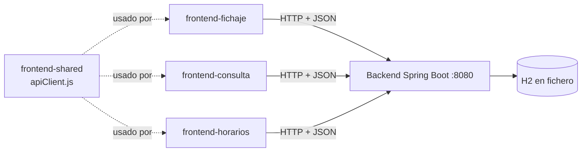

- Los frontends nunca acceden a la base de datos: solo hablan con la API REST.
- `frontend-shared/` no es una aplicación: contiene el adaptador de comunicación (`apiClient.js`), la URL del backend (`config.js`) y los estilos comunes. Las pantallas dependen del contrato `api.xxx(...)`, no de `fetch`, así que el transporte es sustituible sin tocarlas.
- CORS permite orígenes `localhost` y `127.0.0.1` en cualquier puerto (`CorsConfig`).

## Arquitectura del backend (hexagonal)

```
backend/src/main/java/es/ulpgc/control_presencia/backend/
├── domain/                 Java puro, sin Spring ni JPA
├── application/
│   ├── port/in/            casos de uso (interfaces)
│   ├── port/out/           repositorios y reloj (interfaces)
│   └── usecase/            implementaciones de los casos de uso
├── adapter/
│   ├── in/http/            controladores REST, DTOs, mapeo y errores
│   └── out/
│       ├── persistence/    entidades JPA, repositorios Spring Data, adaptadores
│       └── time/           reloj del sistema
└── config/                 beans, CORS y datos iniciales
```

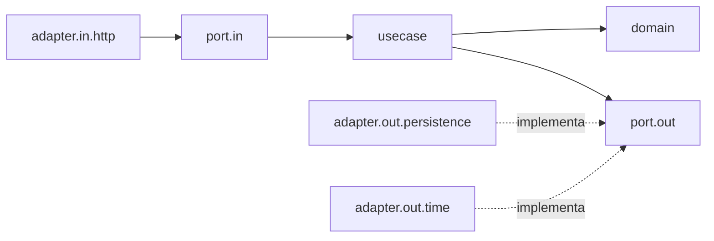

El dominio no conoce nada de fuera, los casos de uso solo usan puertos y los adaptadores implementan los puertos. Los casos de uso no llevan anotaciones de Spring y se cablean en `UseCaseConfig`. El reloj es un puerto (`TimeProvider`) para probar retrasos sin depender de la hora real.

## Modelo de dominio

| Clase | Descripción |
|---|---|
| `Person` | Persona (id, nombre). |
| `ClockEvent` | Fichaje inmutable: persona, instante, tipo (`CLOCK_IN`/`CLOCK_OUT`) y origen (`TERMINAL`, `WEB`, `MOBILE`, `MANUAL`). |
| `TimeSlot` | Tramo horario. Si el fin es anterior al inicio, cruza la medianoche. |
| `Schedule` | Interfaz de horario: `slotsFor(date)` devuelve los tramos que empiezan ese día. |
| `Assignment` | Asignación de un horario a una persona en un periodo (`to` nulo = indefinida). No se permiten solapes. |
| `Incident` | Incidencia detectada: `LATE_ARRIVAL`, `EARLY_DEPARTURE`, `ABSENCE`, `CLOCK_OUT_PENDING`; puede llevar una justificación. |
| `Justification` | Justificación de una incidencia (persona, día, tipo, motivo, autor, instante de registro). |
| `PresenceResult` | Estado, minutos esperados, trabajados, desviación e incidencias. |
| `ClockEventValidator` | Rechaza salida sin entrada, fichaje duplicado y fichaje anterior al último. |
| `PresenceEvaluator` | Servicio de dominio que calcula el estado de presencia. |

Estados de presencia: `NO_SHIFT`, `PENDING`, `PRESENT`, `LATE`, `ABSENT`, `CLOCK_OUT_PENDING`, `COMPLETED`, `WITH_INCIDENT`.

## Tipos de horario soportados

| Tipo | Clase | Ejemplo cargado |
|---|---|---|
| Corrido | `ContinuousSchedule` | `office`: lunes a viernes, 08:00-15:00 |
| Partido | `SplitSchedule` | `restaurant`: martes a domingo, 12:00-16:00 y 19:00-23:00 |
| Turnos y guardias | `ShiftSchedule` | `hospital`: ciclo de 5 días: mañana 08-15, tarde 15-22, guardia 20-08, libre, libre |

- Una **guardia** es un turno cuyo tramo cruza la medianoche (20:00-08:00). La salida del día siguiente se asocia a la jornada que empezó el día anterior.
- `ScheduleFactory` es el único punto donde se decide qué clase de horario crear: no hay condicionales dispersos.
- Personas de ejemplo (ficticias): `ana` (office), `luis` (restaurant), `marta` (hospital), asignadas desde 2026-01-01.

## Reglas de cómputo

- Tolerancia configurable en minutos para entrada y salida.
- Retraso: primera entrada posterior al inicio del primer tramo más la tolerancia.
- Salida temprana: última salida anterior al fin del último tramo menos la tolerancia.
- Horas trabajadas: suma de pares entrada/salida; una entrada abierta cuenta hasta "ahora".
- Desviación: trabajadas menos esperadas.
- Sin fichajes: `PENDING` hasta la tolerancia, `LATE` durante la jornada y `ABSENT` al terminar.
- Ventana de fichajes: para evaluar una jornada solo se consideran los fichajes desde 4 horas antes del primer tramo hasta 4 horas después del último (así una guardia nocturna incluye su salida del día siguiente).
- Una entrada solo se acepta si el horario de la persona tiene jornada ese día (`NO_SHIFT_TODAY`). Las salidas no se restringen, para poder cerrar guardias que empezaron el día anterior.

## Modelo de datos (H2)

| Tabla | Columnas principales |
|---|---|
| `persons` | `id`, `name` |
| `schedules` | `id`, `type`, `name`, `days`, `slots`, `cycle_start`, `cycle` |
| `assignments` | `id`, `person_id`, `schedule_id`, `valid_from`, `valid_to` |
| `clock_events` | `id`, `person_id`, `event_time`, `type`, `event_source`, `recorded_at` |
| `justifications` | `id`, `person_id`, `incident_date`, `incident_type`, `reason`, `author`, `recorded_at` |

`clock_events` y `justifications` son de **solo inserción**: columnas no actualizables y ningún método de actualizar o borrar en el puerto. `recorded_at` guarda cuándo se escribió cada fila (auditoría).

## Contrato de comunicación

Base: `http://localhost:8080/api`. JSON en peticiones y respuestas.

| Método y ruta | Descripción | Éxito |
|---|---|---|
| `GET /people` | Lista personas | 200 |
| `GET /schedules` | Lista horarios | 200 |
| `POST /schedules` | Define un horario | 201 |
| `POST /assignments` | Asigna un horario a una persona | 201 |
| `POST /clock-events` | Registra entrada o salida | 201 |
| `GET /clock-events?personId&from&to` | Fichajes por periodo (`yyyy-MM-dd`, ambas incluidas) | 200 |
| `GET /presence/{personId}?date` | Estado del día (hoy por defecto) | 200 |
| `POST /justifications` | Justifica una incidencia de un día | 201 |
| `GET /justifications?personId&from&to` | Justificaciones por periodo | 200 |

**Registrar un fichaje:** `POST /api/clock-events`

```json
{ "personId": "ana", "type": "CLOCK_IN", "source": "WEB" }
```

Respuesta (201):

```json
{ "personId": "ana", "timestamp": "2026-11-16T08:02:11", "type": "CLOCK_IN", "source": "WEB" }
```

**Estado del día:** `GET /api/presence/ana?date=2026-11-16`. Respuesta (200):

```json
{
  "personId": "ana",
  "date": "2026-11-16",
  "status": "WITH_INCIDENT",
  "expectedMinutes": 420,
  "workedMinutes": 410,
  "deviationMinutes": -10,
  "incidents": [
    { "type": "LATE_ARRIVAL", "minutes": 10, "description": "Late arrival", "justification": null }
  ]
}
```

**Definir un horario:** `POST /api/schedules`

```json
{
  "id": "shop",
  "type": "SPLIT",
  "name": "Tienda",
  "days": ["MONDAY", "TUESDAY"],
  "slots": [
    { "start": "09:00", "end": "13:00" },
    { "start": "17:00", "end": "21:00" }
  ]
}
```

`type` puede ser `CONTINUOUS` (un tramo), `SPLIT` (varios tramos) o `SHIFTS` (con `cycleStart` y `cycle`, una lista de `{name, slots}`).

**Asignar un horario:** `POST /api/assignments`

```json
{ "personId": "ana", "scheduleId": "office", "from": "2026-11-01", "to": null }
```

**Justificar una incidencia:** `POST /api/justifications`

```json
{ "personId": "ana", "date": "2026-11-19", "incidentType": "LATE_ARRIVAL", "reason": "Huelga de guaguas", "author": "Responsable RRHH" }
```

### Errores

Formato común:

```json
{ "code": "PERSON_NOT_FOUND", "message": "Person not found: nadie" }
```

| HTTP | Códigos | Causa |
|---|---|---|
| 404 | `PERSON_NOT_FOUND`, `SCHEDULE_NOT_FOUND` | Persona u horario inexistente |
| 409 | `DUPLICATE_CLOCK_EVENT`, `DUPLICATE_SCHEDULE`, `ASSIGNMENT_OVERLAP`, `DUPLICATE_JUSTIFICATION` | Duplicados, solapes o incidencia ya justificada |
| 422 | `INCONSISTENT_CLOCK_EVENT`, `SCHEDULE_NOT_ASSIGNED`, `NO_SHIFT_TODAY`, `NO_SUCH_INCIDENT`, `INVALID_DATA` | Salida sin entrada, entrada ya abierta, sin horario asignado, entrada en día sin jornada, incidencia inexistente, datos incompletos o inválidos |
| 400 | `BAD_REQUEST` | JSON mal formado o parámetros erróneos |

## Frontends

### Registro de asistencia
Elegir persona, fichar entrada o salida y ver el estado de hoy, con horas esperadas, trabajadas, desviación e incidencias.

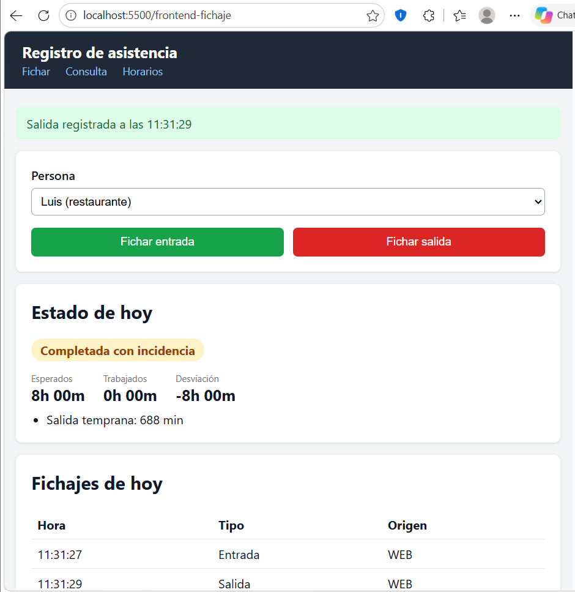
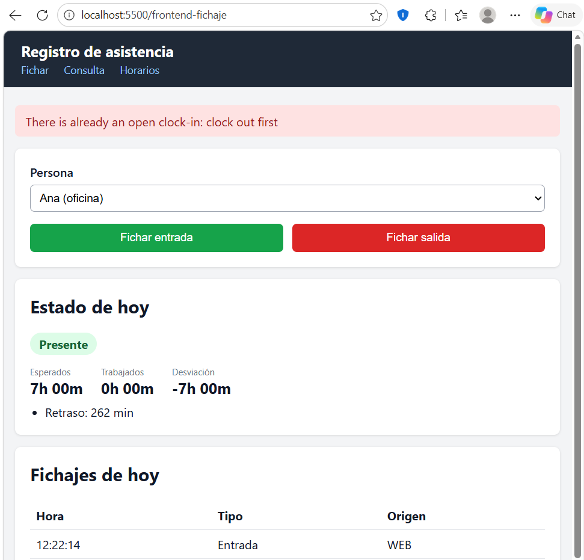
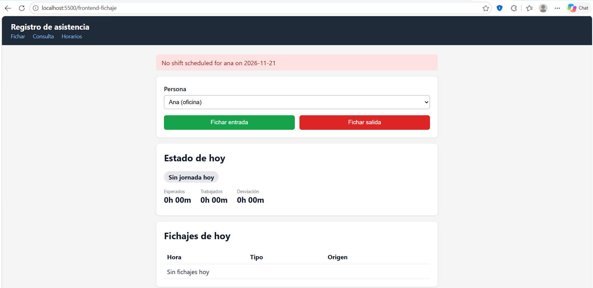

### Consulta de presencia e incidencias
Resumen del periodo, estado por día, incidencias con botón de justificar, justificaciones registradas y fichajes.

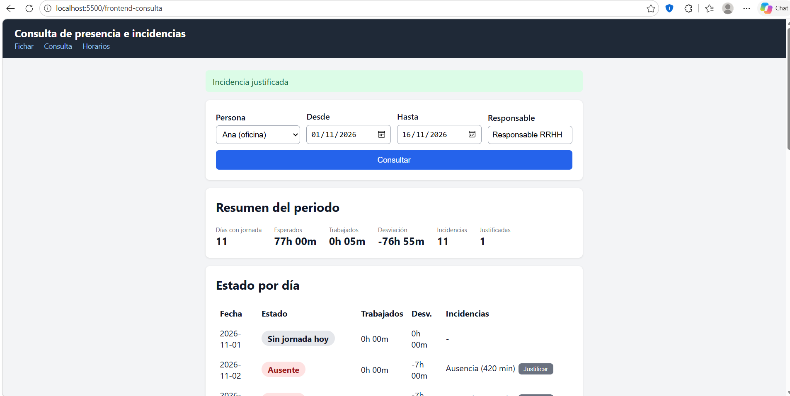

### Definición de horarios
Lista de horarios, alta de un horario corrido, partido o de turnos y asignación a una persona.

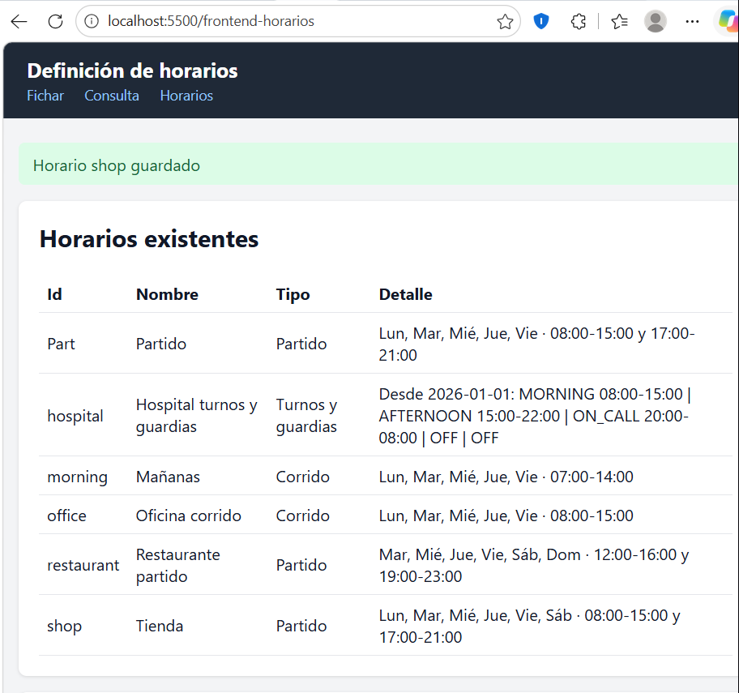
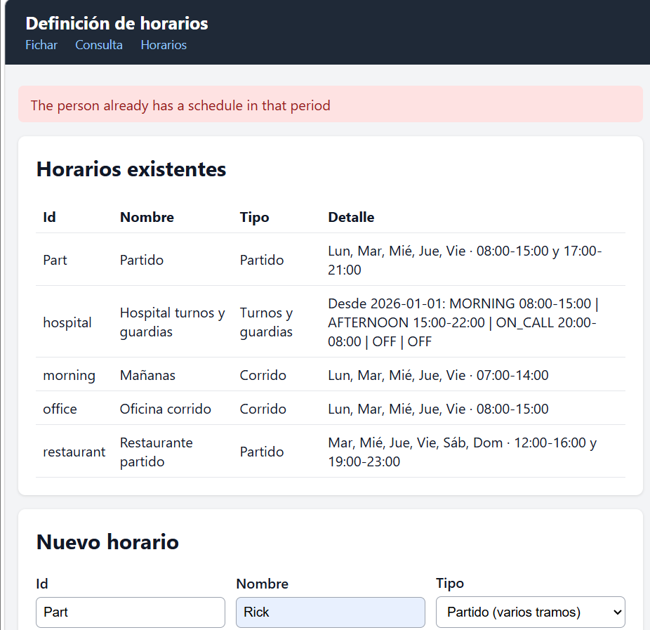

## Idea propia: incidencias justificadas

Un retraso, una salida temprana o una ausencia puede deberse a una causa legítima (huelga de transporte, cita médica). Un responsable puede **justificar una incidencia** con un motivo, y esa justificación queda registrada y auditable.

- `JustifyIncidentService` comprueba que la persona existe, que tiene horario ese día, que la incidencia **existe realmente** y que no estaba ya justificada.
- Persistencia: tabla `justifications`, de solo inserción, con autor y `recorded_at`.
- `JustifiedPresenceService` es un decorador del servicio de presencia que marca cada incidencia con su justificación sin modificar el cálculo base. La incidencia sigue contando como incidencia, pero se muestra justificada.
- Frontend de consulta: botón *Justificar* por incidencia, contador de justificadas y tabla de justificaciones del periodo.

Encaja con el trabajo porque cubre las "incidencias justificadas" que sugiere el enunciado y la exigencia de trazabilidad de las modificaciones.

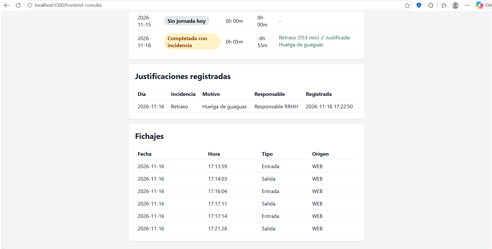

## Verificación

**Automatizada:** `./mvnw test` ejecuta 33 tests, todos correctos: dominio (corrido con retraso, partido, guardia nocturna, salida sin entrada), casos de uso con repositorios en memoria (fichar, errores, estado, ventana de fichajes, entrada sin jornada, definir y asignar horarios, solapes, consulta por periodo, justificaciones) e integración de persistencia con H2 en memoria.

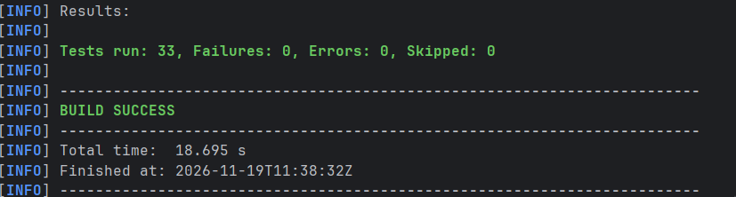

**Manual** (backend y frontends en marcha):

| Prueba | Resultado |
|---|---|
| Fichar entrada y salida desde el frontend | Fichajes registrados y estado actualizado |
| Entrada con otra ya abierta | Rechazada con el mensaje "There is already an open clock-in: clock out first" |
| Entrada en un día sin jornada (Ana, sábado) | Rechazada: "No shift scheduled for ana on 2026-11-21" |
| Fichar con persona inexistente | 404 (`PERSON_NOT_FOUND` comprobado con `curl`) |
| Salida sin entrada previa | 422 |
| Estado de un día sin horario asignado (`presence/ana?date=2025-12-01`) | 422 |
| Asignar un horario solapado | Rechazado: "The person already has a schedule in that period" (409) |
| Crear horario partido `shop` desde la interfaz | Aparece en la lista junto a los de ejemplo |
| Justificar una incidencia | Aparece como justificada, con autor y hora de registro |
| Reinicio del backend | La justificación (registrada 2026-11-19 11:19:09) y los fichajes anteriores siguen en la consulta |

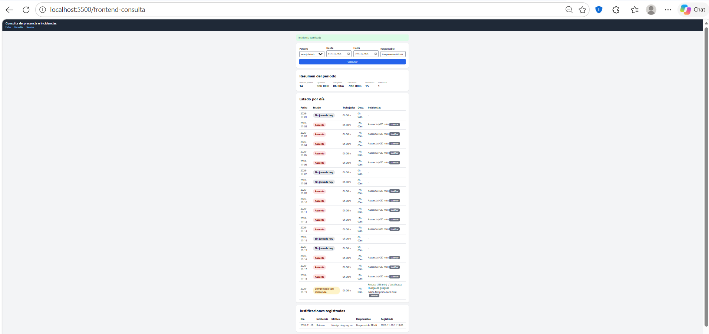
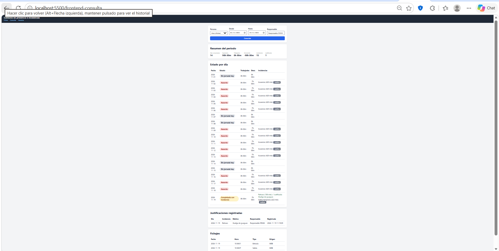

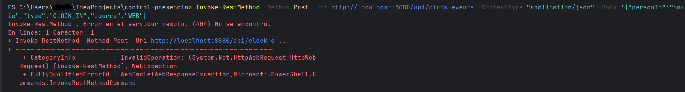
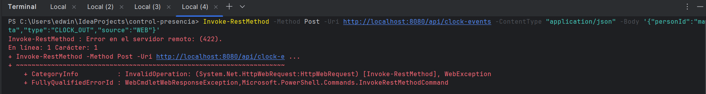
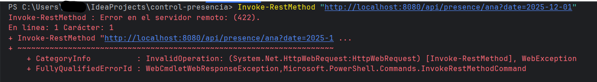

## Límites conocidos

- Retraso medido solo contra el primer tramo del día y salida temprana solo contra el último.
- Ventana de fichajes: si alguien ficha la salida más de 4 horas después del fin del tramo, esa jornada se muestra como `CLOCK_OUT_PENDING`.
- Sin transacciones en los casos de uso: dos fichajes simultáneos de la misma persona podrían colarse.
- Sin autenticación ni permisos: cualquiera puede fichar por cualquier persona; el responsable de una justificación es texto libre.
- Las asignaciones son por persona, no por grupo.
- No hay calendario de festivos ni vacaciones: un festivo se evalúa como día laborable. Una ausencia en festivo puede justificarse manualmente.
- Las incidencias se calculan en cada consulta; solo se persisten sus justificaciones. Una justificación se asocia a (persona, día, tipo) y no se puede editar ni retirar.
- La creación de horarios y asignaciones no deja traza de auditoría propia, y no se pueden editar ni borrar desde la interfaz.
- Los nombres de turno no pueden contener `#` ni `=` (formato de almacenamiento).
- El instante del fichaje es el del servidor.
- El frontend de consulta hace una petición por día del periodo (máximo 62 días).
- Solo una instancia del backend a la vez, y la ruta de la base de datos depende del directorio de arranque.