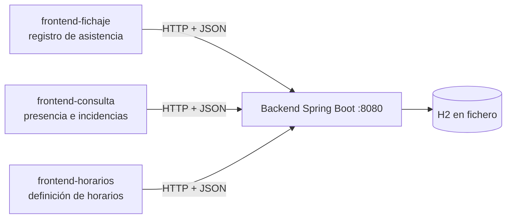
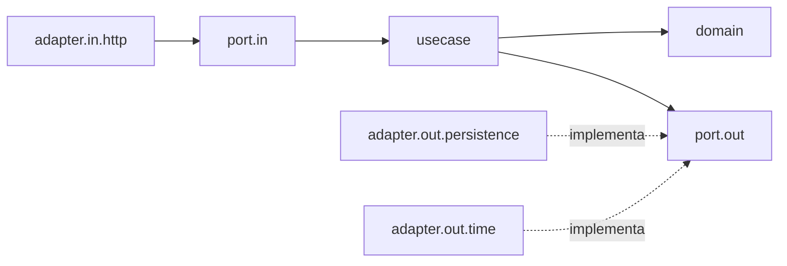

# control-presencia

Sistema de control de presencia: registro de fichajes, definición de horarios (corrido, partido, turnos y guardias) y consulta del cumplimiento horario. Proyecto extraordinario de Ingeniería de Software 2 (ULPGC).

## Objetivo

Registrar entradas y salidas de personas, evaluarlas contra el horario que tienen asignado y consultar el estado resultante (presente, retraso, ausente, salida pendiente, incidencias, horas trabajadas y desviación). El sistema se compone de un backend y tres módulos frontend independientes.

> Estado: backend completo y verificado. Frontends, idea propia y capturas, pendientes.

## Requisitos y dependencias

- JDK 25 (el configurado en `backend/pom.xml`)
- Maven Wrapper incluido (`mvnw`), no hace falta instalar Maven
- Spring Boot 4 (Web, Data JPA, Validation), base de datos H2 en fichero
- Variable de entorno `JAVA_HOME` apuntando al JDK

## Cómo compilar y ejecutar el backend

```bash
cd backend
./mvnw test              # Windows: .\mvnw test
./mvnw spring-boot:run   # Windows: .\mvnw spring-boot:run
```

- Puerto: `8080` (`server.port` en `application.properties`)
- Base de datos: H2 en fichero `backend/data/presencia` (ruta relativa, ignorada por git). Persiste entre reinicios.
- Consola H2: `http://localhost:8080/h2-console`
- Datos iniciales: `DataInitializer` crea, solo si la base está vacía, 3 personas ficticias y 3 horarios (ver más abajo). Se desactiva con `app.seed-data=false`.
- Tolerancia de entrada y salida: `presence.tolerance-minutes` (por defecto 5).
- Los tests usan H2 en memoria (`src/test/resources/application.properties`) y no tocan la base real.

## Arquitectura de sistemas



- Los frontends nunca acceden a la base de datos: solo hablan con la API REST.
- CORS permite orígenes `localhost` y `127.0.0.1` en cualquier puerto (`CorsConfig`).
- Cada frontend usará un servicio HTTP sustituible (pendiente).

## Arquitectura del backend (hexagonal)

```
backend/src/main/java/es/ulpgc/control_presencia/backend/
├── domain/                 Java puro, sin Spring ni JPA
├── application/
│   ├── port/in/            casos de uso (interfaces)
│   ├── port/out/           repositorios y reloj (interfaces)
│   └── usecase/            implementaciones de los casos de uso
├── adapter/
│   ├── in/http/            controladores REST, DTOs, mapeo y errores
│   └── out/
│       ├── persistence/    entidades JPA, repositorios Spring Data, adaptadores
│       └── time/           reloj del sistema
└── config/                 beans, CORS y datos iniciales
```



Reglas de dependencia: el dominio no conoce nada de fuera; los casos de uso solo usan puertos; los adaptadores implementan los puertos. Los casos de uso no llevan anotaciones de Spring y se cablean en `UseCaseConfig`. El reloj es un puerto (`TimeProvider`) para poder probar retrasos sin depender de la hora real.

## Modelo de dominio

| Clase | Descripción |
|---|---|
| `Person` | Persona (id, nombre). |
| `ClockEvent` | Fichaje inmutable: persona, instante, tipo (`CLOCK_IN`/`CLOCK_OUT`) y origen (`TERMINAL`, `WEB`, `MOBILE`, `MANUAL`). |
| `TimeSlot` | Tramo horario. Si el fin es anterior al inicio, cruza la medianoche. |
| `Schedule` | Interfaz de horario: `slotsFor(date)` devuelve los tramos que empiezan ese día. |
| `Assignment` | Asignación de un horario a una persona en un periodo (`to` nulo = indefinida). No se permiten solapes. |
| `Incident` | Incidencia detectada: `LATE_ARRIVAL`, `EARLY_DEPARTURE`, `ABSENCE`, `CLOCK_OUT_PENDING`. |
| `PresenceResult` | Estado, minutos esperados, trabajados, desviación e incidencias. |
| `ClockEventValidator` | Rechaza salida sin entrada, fichaje duplicado y fichaje anterior al último. |
| `PresenceEvaluator` | Servicio de dominio que calcula el estado de presencia. |

Estados de presencia: `NO_SHIFT`, `PENDING`, `PRESENT`, `LATE`, `ABSENT`, `CLOCK_OUT_PENDING`, `COMPLETED`, `WITH_INCIDENT`.

## Tipos de horario soportados

| Tipo | Clase | Ejemplo cargado |
|---|---|---|
| Corrido | `ContinuousSchedule` | `office`: lunes a viernes, 08:00-15:00 |
| Partido | `SplitSchedule` | `restaurant`: martes a domingo, 12:00-16:00 y 19:00-23:00 |
| Turnos y guardias | `ShiftSchedule` | `hospital`: ciclo de 5 días: mañana 08-15, tarde 15-22, guardia 20-08, libre, libre |

- Una **guardia** es un turno cuyo tramo cruza la medianoche (20:00-08:00). La salida del día siguiente se asocia a la jornada que empezó el día anterior.
- `ScheduleFactory` es el único punto donde se decide qué clase de horario crear.
- Personas de ejemplo (ficticias): `ana` (office), `luis` (restaurant), `marta` (hospital), asignadas desde 2026-01-01.

## Reglas de cómputo

- Tolerancia configurable en minutos para entrada y salida.
- Retraso: primera entrada posterior al inicio del primer tramo más la tolerancia.
- Salida temprana: última salida anterior al fin del último tramo menos la tolerancia.
- Horas trabajadas: suma de pares entrada/salida; una entrada abierta cuenta hasta "ahora".
- Desviación: trabajadas menos esperadas.
- Sin fichajes: `PENDING` hasta la tolerancia, `LATE` durante la jornada y `ABSENT` al terminar.

## Modelo de datos (H2)

| Tabla | Columnas principales |
|---|---|
| `persons` | `id`, `name` |
| `schedules` | `id`, `type`, `name`, `days`, `slots`, `cycle_start`, `cycle` |
| `assignments` | `id`, `person_id`, `schedule_id`, `valid_from`, `valid_to` |
| `clock_events` | `id`, `person_id`, `event_time`, `type`, `event_source`, `recorded_at` |

`clock_events` es de **solo inserción**: columnas no actualizables y ningún método de actualizar o borrar en el puerto. `recorded_at` guarda cuándo se escribió cada fila (auditoría).

## Contrato de comunicación

Base: `http://localhost:8080/api`. JSON en peticiones y respuestas.

| Método y ruta | Descripción | Éxito |
|---|---|---|
| `GET /people` | Lista personas | 200 |
| `GET /schedules` | Lista horarios | 200 |
| `POST /schedules` | Define un horario | 201 |
| `POST /assignments` | Asigna un horario a una persona | 201 |
| `POST /clock-events` | Registra entrada o salida | 201 |
| `GET /clock-events?personId&from&to` | Fichajes